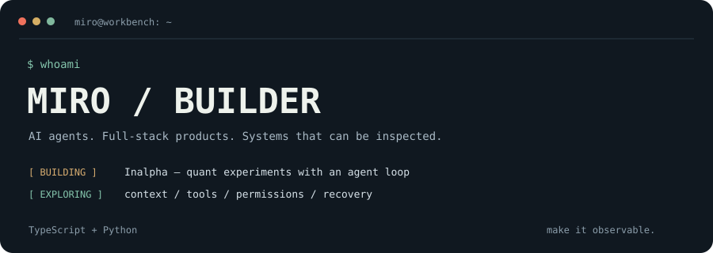
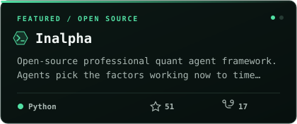
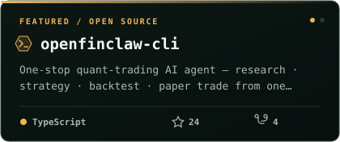
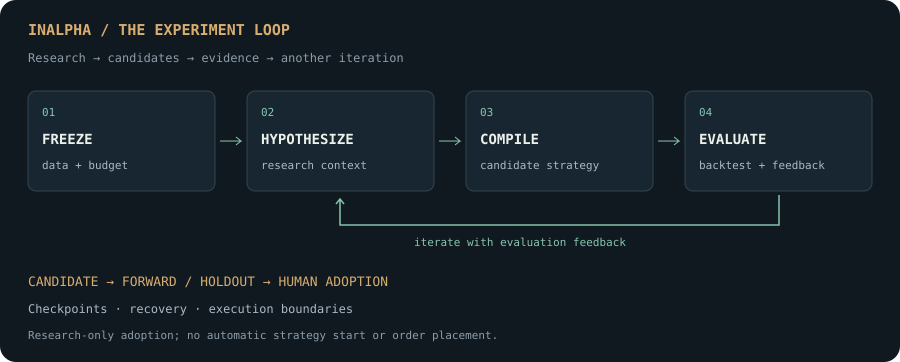
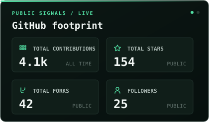
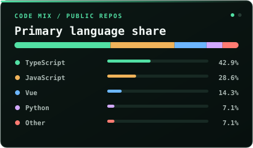

<p align="center">
  
</p>

<p align="center">
  <a href="https://inalpha.dev"></a>
  <a href="mailto:926320181@qq.com"></a>
  <a href="https://www.linkedin.com/in/miro-chen-467023301"></a>
</p>

我是 **Miro**。写前端，也写后端；最近更关心 Agent 如何组织上下文、调用工具，以及在执行中断后继续工作。

*8 years in frontend & full-stack. Now building AI products and experimenting with agent systems.*

### `~/projects`

<a href="https://github.com/mirror29/inalpha"></a>
<a href="https://github.com/mirror29/openfinclaw-cli"></a>

**🦊 Inalpha** 是我独立设计开发的开源量化实验框架：让 Agent 做研究、生成策略和迭代实验，用工程机制约束执行边界。

- **Research → UI** — 多视角研究、多空讨论、因子分析与衰减巡检，连接 Next.js 控制台、Mastra 编排和 Python 服务。
- **Agent Loop** — 从冻结数据和预算开始，把假设、候选策略、回测反馈接成循环；用持久化状态、检查点和租约恢复追踪实验。
- **Harness** — 代码审计、受限执行、接口校验，以及 propose → approve → execute 审批链路。实验采用与模拟盘执行分别控制。



[Explore the code ↗](https://github.com/mirror29/inalpha) · [Visit Inalpha ↗](https://inalpha.dev) · [中文文档 ↗](https://github.com/mirror29/inalpha/blob/main/README.zh-CN.md)

<sub>持续迭代中：进化系统的完整正向生产验收仍待完成。[实现与验证状态](https://github.com/mirror29/inalpha/blob/main/docs/04-current-state.md)。</sub>

**OpenFinClaw CLI** — 给终端与 Agent 的量化工具入口。TypeScript CLI + MCP Server，npm 包 `@openfinclaw/cli`，附交互式安装向导。[Source ↗](https://github.com/mirror29/openfinclaw-cli)

### `~/toolbox`


```text
context   → RAG / on-demand skills / task context
execution → tools / permissions / sandboxing / human handoff
recovery  → checkpoints / execution traces / task resumption
shipping  → components / monorepo / CI / tests / performance
```

### `~/other-builds`

- **[Owlume ↗](https://www.owlume.work/)** — 电商家居 Agent 项目负责人。OpenAI Agents SDK × CopilotKit / AG-UI × Tldraw，把 Agent 和可编辑画布连接起来。
- **Desktop agents** — Electron × PI Agent，做过 Skill 管理、会话隔离、人工接管与任务恢复。
- **Workflow tools** — GEO 多平台答案与引用采集；飞书协作助手串联需求、缺陷、源码分析和研发日报。
- **[wangEditor-formula ↗](https://github.com/mirror29/wangEditor-formula)** — 早期的公式编辑器插件实践，连接 kityformula 与 myscript-math-web。

<details>
<summary><b>📊 GitHub telemetry</b></summary>
<br />


</details>

---

<p align="center"><i>做个梦给你 · Building Inalpha 🦊</i><br /><sub><a href="mailto:926320181@qq.com">926320181@qq.com</a> · <a href="https://inalpha.dev">inalpha.dev</a></sub></p>
